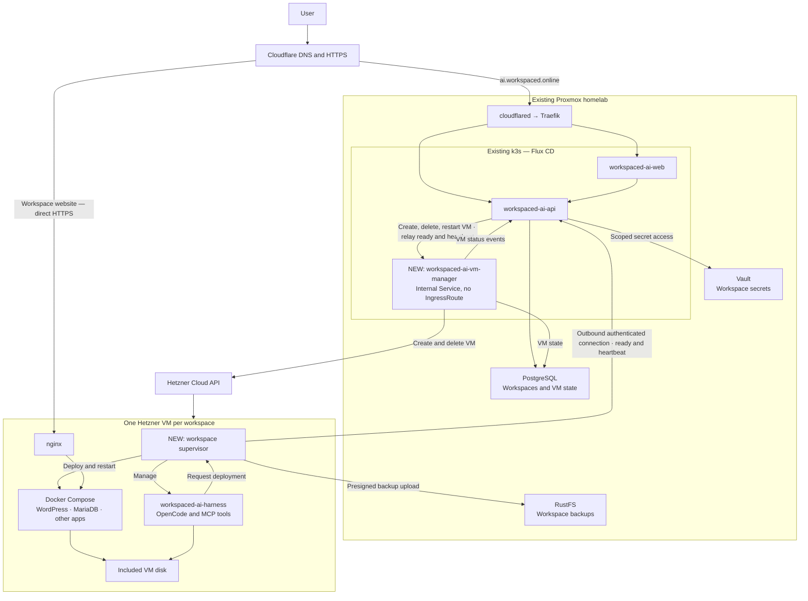

# Next goal: Hetzner VM workspaces

Move workspaces from the current Kubernetes pod runtime to isolated Hetzner VMs, while keeping central management
on our existing infrastructure to minimize costs.

Central management is a new internal service, `workspaced-ai-vm-manager` (`apps/vm-manager`). It runs in k3s
behind a ClusterIP Service with no IngressRoute, so only the workspace API reaches it. VMs report ready and send
heartbeats to the public workspace API, which relays them to the VM manager.

Raw plan:



## VM sizes

Start with CX23 and CX33. Add CX43 later if users need larger workspaces. These are shared-CPU, x86 options that
fit the cost-focused approach.

| VM model             | vCPU | RAM   | Included disk | Recommended use                                                   |
|----------------------|------|-------|---------------|-------------------------------------------------------------------|
| CX23 — default       | 2    | 4 GB  | 40 GB         | Harness plus a small WordPress/MariaDB site or lightweight app    |
| CX33 — larger option | 4    | 8 GB  | 80 GB         | Builds, several services, or applications needing more memory     |
| CX43 — later         | 8    | 16 GB | 160 GB        | Heavier builds and larger workloads                               |

`GET /api/v1/vm-options` on the VM manager lists them; see [vm-manager.md](vm-manager.md).

## VM image

Every VM is to boot from `workspace-vm`, a Hetzner snapshot built with Packer from [`vm-image/`](../vm-image): Ubuntu
24.04 with Docker from Docker's own repository, unattended upgrades for both, and SSH masked, since the firewall lets
nothing reach a VM inbound anyway. The image holds no secrets and nothing specific to one VM; cloud-init is reset so each
VM boots as a new instance. Snapshots are labelled `image=workspace-vm`, so a consumer picks the newest by label rather
than by id.

It is built weekly, and on demand, by the homelab's `packer-build` pipeline, which clones this repo and builds
`vm-image/` with the VM manager's Hetzner token from Vault, keeping the three newest snapshots. A local build needs only
that token:

```sh
cd vm-image
packer init . && \
  PKR_VAR_hcloud_token=$(vault kv get -field=hcloud-token secret/workspaced-vm-manager-secrets) packer build .
```

The VM manager still creates VMs from `ubuntu-24.04` until it is switched to the snapshot.
