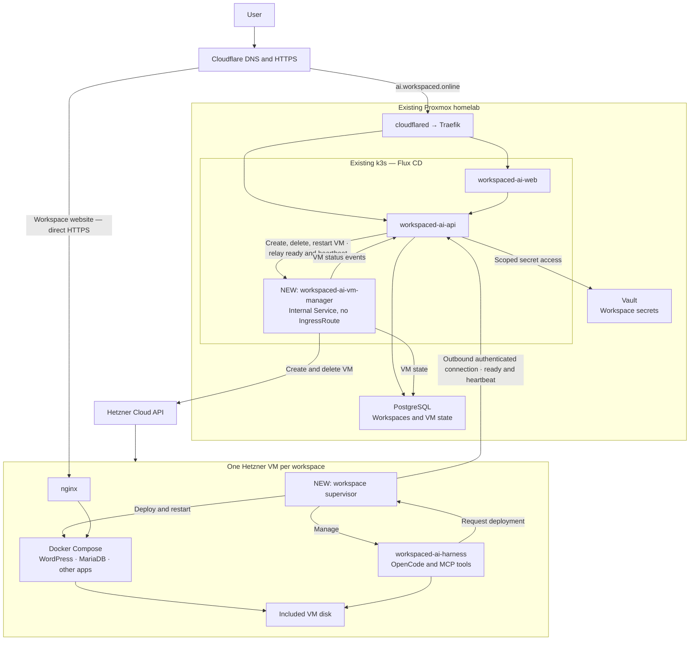

# Next goal: Hetzner VM workspaces

Move workspaces from the current Kubernetes pod runtime to isolated Hetzner VMs, while keeping central management
on our existing infrastructure to minimize costs.

Central management is a new internal service, `workspaced-ai-vm-manager` (`apps/vm-manager`). It runs in k3s
behind a ClusterIP Service with no IngressRoute, so only the workspace API and the agent hub reach it. Each VM runs
the supervisor (`apps/supervisor`), which enrolls with the [agent hub](agent-hub.md) at `agent.workspaced.online`
and sends it signed ready and heartbeat reports; the agent hub relays them to the VM manager.

Raw plan:

## VM sizes

Start with CX23 and CX33. Add CX43 later if users need larger workspaces. These are shared-CPU, x86 options that
fit the cost-focused approach.

| VM model             | vCPU | RAM   | Included disk | Recommended use                                                   |
|----------------------|------|-------|---------------|-------------------------------------------------------------------|
| CX23 — default       | 2    | 4 GB  | 40 GB         | Harness plus a small WordPress/MariaDB site or lightweight app    |
| CX33 — larger option | 4    | 8 GB  | 80 GB         | Builds, several services, or applications needing more memory     |
| CX43 — later         | 8    | 16 GB | 160 GB        | Heavier builds and larger workloads                               |

`GET /api/v1/vm-options` on the VM manager lists them; see [vm-manager.md](vm-manager.md).

## VM image

Every VM is to boot from `workspace-vm`, a Hetzner snapshot rather than an ISO: Hetzner Cloud cannot create a server
from an uploaded ISO, so the homelab's `packer-build` pipeline boots a throwaway server, installs Docker and unattended
upgrades, masks SSH, installs the supervisor as a systemd unit pinned to the digest `:latest` resolved to at build
time, and saves the disk as a snapshot labelled `image=workspace-vm`. It holds no secrets and nothing specific to one
VM, is rebuilt weekly, and the three newest are kept; the VM manager creates every VM from the newest. A new
supervisor reaches VMs with the next image build, so rebuild by hand after releasing one.
