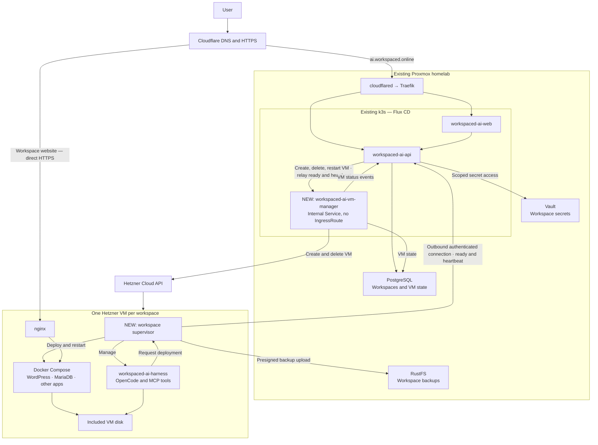

# Next goal: Hetzner VM workspaces

Move workspaces from the current Kubernetes pod runtime to isolated Hetzner VMs, while keeping central management
on our existing infrastructure to minimize costs.

Central management is a new internal service, `workspaced-ai-vm-manager` (`apps/vm-manager`). It runs in k3s
behind a ClusterIP Service with no IngressRoute, so only the workspace API reaches it. VMs report ready and send
heartbeats to the public workspace API, which relays them to the VM manager.

Raw plan:

