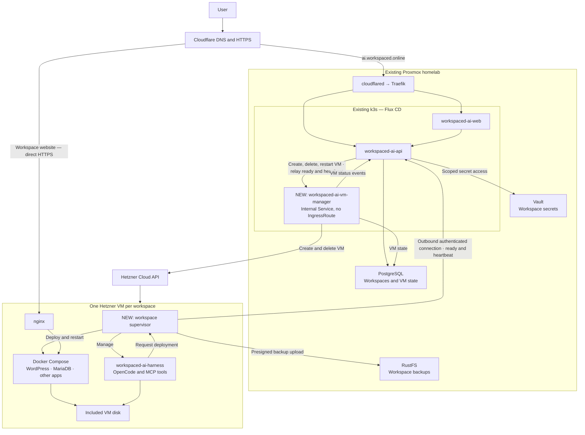

# Next goal: Hetzner VM workspaces

Move workspaces from the current Kubernetes pod runtime to isolated Hetzner VMs, while keeping central management
on our existing infrastructure to minimize costs.

Central management is a new internal service, `workspaced-ai-vm-manager` (`apps/vm-manager`). It runs in k3s
behind a ClusterIP Service with no IngressRoute, so only the workspace API reaches it. VMs report ready and send
heartbeats to the public workspace API, which relays them to the VM manager.

Raw plan:



## VM sizes

Start with CX23 and CX33. Add CX43 later if users need larger workspaces. These are shared-CPU, x86 options that
fit the cost-focused approach.

| VM model             | vCPU | RAM   | Included disk | Recommended use                                                   |
|----------------------|------|-------|---------------|-------------------------------------------------------------------|
| CX23 — default       | 2    | 4 GB  | 40 GB         | Harness plus a small WordPress/MariaDB site or lightweight app    |
| CX33 — larger option | 4    | 8 GB  | 80 GB         | Builds, several services, or applications needing more memory     |
| CX43 — later         | 8    | 16 GB | 160 GB        | Heavier builds and larger workloads                               |

`GET /api/v1/vm-options` on the VM manager lists the sizes on offer, default first, with their specs and monthly
price as Hetzner currently sells them in the configured location. Which sizes exist is configuration
(`WORKSPACED_VM_SERVER_TYPES`, `cx23,cx33` by default); specs and prices are never restated, they come from
Hetzner. A size Hetzner deprecates or stops selling in the location drops out of the list, and creating a VM
with a size that is not listed answers 400. Adding CX43 is `WORKSPACED_VM_SERVER_TYPES=cx23,cx33,cx43`.

## Hetzner access

VMs live in their own Hetzner Cloud project, so its API token can reach nothing else. The token is a Read & Write
one, kept in Vault at `secret/workspaced-vm-manager-secrets` under `hcloud-token`, and reaches the VM manager as
`WORKSPACED_HETZNER_TOKEN` through an ExternalSecret. Without it the VM manager still starts, and anything that
needs Hetzner answers 503. VMs are created in `nbg1` unless `WORKSPACED_HETZNER_LOCATION` says otherwise.

To run it locally against the real project:

```bash
WORKSPACED_HETZNER_TOKEN=$(vault kv get -field=hcloud-token secret/workspaced-vm-manager-secrets) \
  mvn -f apps/vm-manager spring-boot:run
curl -s localhost:8081/api/v1/vm-options
```
